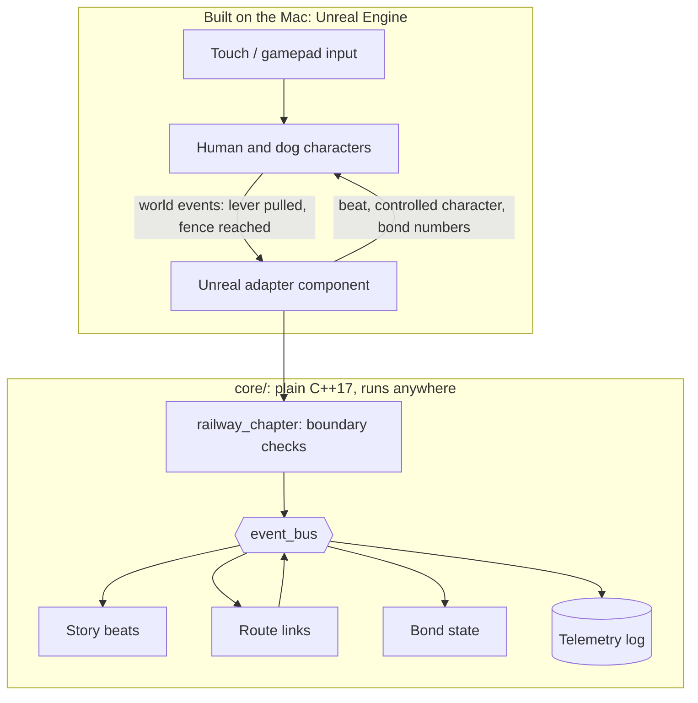

# Architecture

## Shape

The engine knows where things are and what the player pressed. The core knows what those events mean for the story. The adapter (written later, on the Mac) is the only code that touches both.

## Decisions

**1. Game rules live in an engine-independent C++ core.**
- Constraint: cloud sessions run on a Linux virtual machine with no Unreal Engine, no GPU, no Xcode and a 30 GB disk, so they can't open the Unreal project. The same rules must also carry into the later PC game.
- Strongest rejected alternative: write the rules directly as Unreal C++ classes or Blueprints. That's less code in total and is how many Unreal tutorials work.
- What breaks otherwise: code written in the cloud would never compile until the Mac, and no test could run without the editor.

**2. The core compiles with exceptions and RTTI switched off.**
- Constraint: Unreal builds game modules that way by default.
- Strongest rejected alternative: ordinary C++ with both on, which allows simpler error handling.
- What breaks otherwise: the core compiles in the cloud, then fails when it's moved into Unreal.

**3. The engine reports events by name; the core decides what they mean.**
- Constraint: the core has no physics or positions, and level designers need to rearrange levels without changing code.
- Strongest rejected alternative: the core simulates positions itself, which allows deeper testing.
- What breaks otherwise: two copies of the world, one in Unreal and one in the core, that drift apart.

**4. Effects of route links are internal-only events.**
- Constraint: the reunion must be earned by actions on both routes.
- Strongest rejected alternative: accept any event name from the engine, which is simpler.
- What breaks otherwise: one wrong Blueprint call announcing `shared_route_opened` skips the final obstacle.

**5. The playtest log is JSON Lines, with escaping, a time check and a size cap.**
- Constraint: playtest numbers (for example, seconds lingering at the fence) must be analyzable, and logged text can originate outside the core.
- Strongest rejected alternative: plain text or CSV, which is easier to eyeball.
- What breaks otherwise: a quote character in a name injects fake fields, a backwards clock corrupts durations, and a runaway loop fills the phone's memory.

**6. A tiny test harness lives in the repository.**
- Constraint: no downloads during builds, and the test code has to be readable by a beginner.
- Strongest rejected alternative: GoogleTest or Catch2, which give better failure messages and more features.
- What breaks otherwise: nothing yet. Revisit when the test count grows past a few hundred checks.

## Secure against what, under which assumptions

Malformed or out-of-order events and times from the engine boundary (bad names, oversized names, spoofed internal events, NaN or backwards times) can't crash the core, skip story beats or corrupt the log. This assumes:
- callers use only the public functions in `railway_chapter.hpp`, and
- the core runs inside the game process (a memory-level attacker is out of scope).

**Not yet covered:**
- Save files.
- Invalid UTF-8 inside logged text. It's passed through, so it can make one log line invalid JSON.
