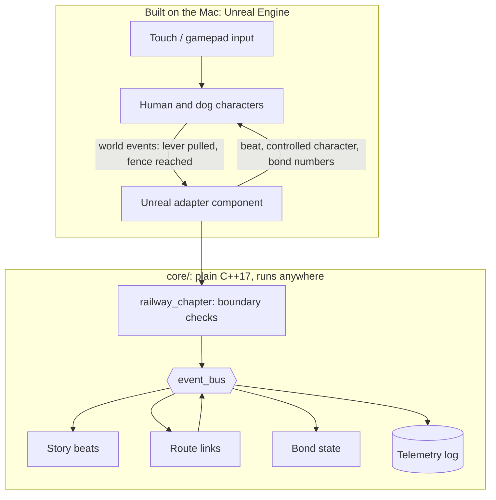

# Architecture

## Shape

The engine knows where things are and what the player pressed. The core knows what those events mean for the story. The adapter (written later, on the Mac) is the only code that touches both.

## Decisions

**1. Game rules live in an engine-independent C++ core.**
- Constraint: cloud sessions run on a Linux virtual machine with no Unreal Engine, no GPU, no Xcode and a 30 GB disk, so they can't open the Unreal project. The same rules must also carry into the later PC game.
- Strongest rejected alternative: write the rules directly as Unreal C++ classes or Blueprints. That's less code in total and is how many Unreal tutorials work.
- What breaks otherwise: code written in the cloud would never compile until the Mac, and no test could run without the editor.

**2. The core compiles with exceptions and RTTI switched off.**
- Constraint: Unreal builds game modules that way by default.
- Strongest rejected alternative: ordinary C++ with both on, which allows simpler error handling.
- What breaks otherwise: the core compiles in the cloud, then fails when it's moved into Unreal.

**3. The engine reports events by name; the core decides what they mean.**
- Constraint: the core has no physics or positions, and level designers need to rearrange levels without changing code.
- Strongest rejected alternative: the core simulates positions itself, which allows deeper testing.
- What breaks otherwise: two copies of the world, one in Unreal and one in the core, that drift apart.

**4. Effects of route links are internal-only events.**
- Constraint: the reunion must be earned by actions on both routes.
- Strongest rejected alternative: accept any event name from the engine, which is simpler.
- What breaks otherwise: one wrong Blueprint call announcing `shared_route_opened` skips the final obstacle.

**5. The playtest log is JSON Lines, with escaping, a time check and a size cap.**
- Constraint: playtest numbers (for example, seconds lingering at the fence) must be analyzable, and logged text can originate outside the core.
- Strongest rejected alternative: plain text or CSV, which is easier to eyeball.
- What breaks otherwise: a quote character in a name injects fake fields, a backwards clock corrupts durations, and a runaway loop fills the phone's memory.

**6. A tiny test harness lives in the repository.**
- Constraint: no downloads during builds, and the test code has to be readable by a beginner.
- Strongest rejected alternative: GoogleTest or Catch2, which give better failure messages and more features.
- What breaks otherwise: nothing yet. Revisit when the test count grows past a few hundred checks.

**7. Save files are versioned "name value" text with whole numbers only.**
- Constraint: the file lives on the player's device, so it can be edited, cut short by a crash, or left by another game version. Decimal parsing in C++ (`strtod`) depends on the phone's language settings, and the newer locale-free tool (`std::from_chars` for decimals) isn't available in every Apple compiler.
- Strongest rejected alternative: JSON, which matches the playtest log and has tooling.
- What breaks otherwise: a JSON parser is far more code to make hostile-input safe; decimals could load differently on a French-language phone. The cost: times are kept to the millisecond (rounded down) and feelings to the millionth.

**8. The iOS release is a native app that carries the finished browser game inside it.**
- Constraint: the owner wants the game on the App Store soon. The whole story, the painted art, the motion system and the automated tests already exist as a browser game (`prototype/web/`), and one person is building it.
- Strongest rejected alternatives:
  - Rebuilding in Unreal (the original plan in decision 1): real 3D and the most room to grow, but it means rebuilding everything, learning a heavy engine, and a large app for a 2D game.
  - Rebuilding in SpriteKit, Apple's 2D engine: the most native, but the engine code would be rewritten.
- What breaks otherwise: months of rebuilding before anyone can play the game on an iPhone.
- The cost, stated honestly:
  - There are now two copies of the chapter rules, the C++ one in `core/` and the JavaScript one in the game, and they can drift apart. For the iOS release, the game's own rules are the ones that ship.
  - `core/` stays the foundation for a later engine build (the PC game).
- How it works: `ios/` holds a two-file Swift app. It loads the game from inside the app with no internet. `ios/bundle_game.sh` copies the game, art and fonts in before every build. Steps are in `docs/app_store.md`.

**9. The game's saves list the story so far and replay it.**
- Constraint: the player can leave mid-chapter at any moment (a phone call, the lock button), and a regular game puts them back exactly there. The live world holds dozens of moving parts (gates, water levels, timers, who is in control).
- Strongest rejected alternative: copy the whole live world into the save. That is more direct, but every new feature would need its own save and load code, and a missed field would load a broken chapter.
- How it works (`prototype/web/js/save_game.js`): a save holds the chapter's story events in order, where the two of them stand, Bodhi's needs and the bond. Loading builds the chapter fresh and replays the events silently through the same story rules.
- What breaks otherwise: a save written by one version of the game wouldn't load correctly in the next.

**10. The iOS app plays its sound even when the iPhone is on silent, mixed with the player's own music.**
- Constraint: the story leans on sound (the call, barks, rain), and many people keep their phone on silent all day. Without setting this, sound from the game's web view follows the silent switch, so those players would hear nothing and never know why.
- Strongest rejected alternative: Apple's "ambient" setting, which most casual games use. It respects the silent switch, and some players expect that.
- What breaks otherwise: a silent-mode player misses the story's sound cues on first launch, which is when a narrative game is judged.
- How it works: `UntilWeFindHomeApp.swift` sets the app's audio session to "playback" with "mix with others" when the app starts. Playback ignores the silent switch; mixing keeps the player's podcast or music going instead of stopping it.
- Not yet proven: this has not run on an iPhone. The checks in `docs/app_store.md` step 9 test it. If the game's web view doesn't follow the app's setting, the fallback is to switch to ambient and add an on-screen hint to turn sound on.

## Secure against what, under which assumptions

Malformed or out-of-order events and times from the engine boundary (bad names, oversized names, spoofed internal events, NaN or backwards times) can't crash the core, skip story beats or corrupt the log. This assumes:
- callers use only the public functions in `railway_chapter.hpp`, and
- the core runs inside the game process (a memory-level attacker is out of scope).

Save files (`railway_chapter::load_progress`) can't crash the core or leave a chapter half-loaded: the loader refuses files over 4096 bytes, unknown versions, unknown fields and beats, duplicate or missing fields, out-of-range numbers and combinations the story can't reach, and changes nothing unless every check passes. A test feeds 10,000 randomly damaged files through it under the sanitizer build.

The browser game's saves (`read_save` in `prototype/web/js/save_game.js`) are treated the same way. A save is refused and counted, and the chapter starts from its beginning instead, if it:
- is over 16 KB, or isn't readable;
- comes from another version or names a chapter that doesn't exist;
- names an event that can't happen in that chapter, repeats an event, or contains the event that ends a chapter;
- puts a character outside the world or inside a wall, or names an unknown character.

Numbers in it are cleaned, never trusted (`checked_care`). Like the core's saves, it isn't signed: a player can still edit one into a state the story could reach.

**Not yet covered:**
- Save files are not signed, so a player can still hand-edit one to any *reachable* state (for example, the start of the final obstacle). That's acceptable for a single-player story.
- Invalid UTF-8 inside logged text. It's passed through, so it can make one log line invalid JSON.
