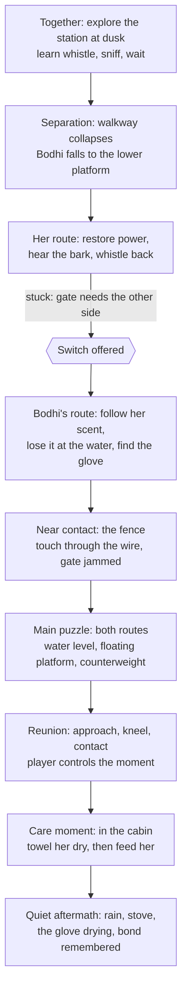
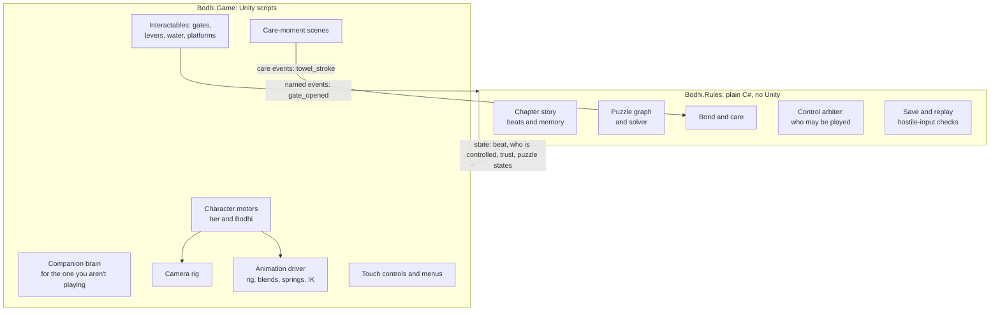
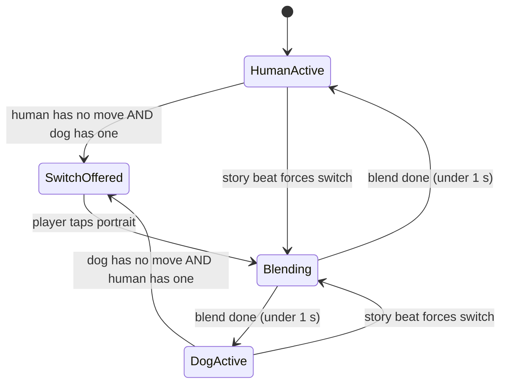

# Unity rebuild: design spec (proposed, waiting for the owner's approval)

**Status:** proposal. No Unity code is written until the owner approves this document.
**Scope:** the next version of *Until We Find Home*, rebuilt in Unity, starting with one deep chapter on the owner's iPhone.
**Reader:** someone new to programming. Every term is explained the first time it appears.

## 0. The owner's goals, in his words (24 Nov 2026)

> "smoothness [in] the transitions and also the graphics, something like Silksong ... look at the game Stray ... the graphics and the smoothness is real."
> "more adventure and build depth to the story line. not breadth but depth."
> "ways the main character can take care of the dog ... feeding him, bathing him, grooming him ... building that bond."
> "some chapters you play as Bodhi, some as the character, or parts of it depending on who is stuck."
> "a bit puzzle type, challenging."
> "use a systems engineering and a TDD approach."

Silksong and Stray are **quality references only**: how fluid, how crafted, how atmospheric. We do not copy their art, characters, levels or style. Bodhi keeps its own look: warm lamplight in cold, wet dark (`docs/art_and_production.md`).

**Two methods, defined:**
- **Systems engineering:** turn wishes into measurable requirements, design parts with clear boundaries, and prove each requirement with a named check. The chain is need, then requirement, then design, then verification. Each link points to the one before it, so nothing gets built that no goal asked for.
- **Test-driven development (TDD):** for every behaviour, first write a small automated test that fails because the behaviour doesn't exist yet (red). Then write the least code that makes it pass (green). Then tidy the code while the test keeps passing (refactor). The tests become a safety net: any later change that breaks a behaviour turns a test red.

## 1. Needs and requirements

Each need (N) comes from a goal above. Each requirement (R) is something a test or a person can check.

Verification codes:
- **T:** an automated test.
- **D:** a demonstration that the owner judges on his iPhone.
- **I:** an inspection of art or documents.

| ID | Requirement | Check |
|---|---|---|
| **N1** | **Smooth movement and transitions** | |
| R1.1 | Characters are posed fresh on every displayed frame. No pose is held for more than one frame during idle, walk, run or jump, so there's no flipbook stepping. | T |
| R1.2 | Moves blend into each other in 0.10 to 0.25 seconds (idle to walk, walk to run, run to jump). | T |
| R1.3 | Movement uses the existing tuned numbers: acceleration, braking, turning, and gravity that is heavier falling than rising (`docs/art_and_production.md`, "How things move"). | T |
| R1.4 | The camera follows with critical damping: it eases in, never overshoots, and its zoom glides over about 0.7 seconds. | T |
| R1.5 | On the target iPhone, 99% of frames finish within 20 ms at 60 frames a second, for a 15-minute play, measured on the device. | T + D |
| R1.6 | The game draws at the screen's native resolution. | T |
| R1.7 | Moving between rooms, scenes and characters uses blends or camera moves, never cuts to black (except film scenes). | D |
| **N2** | **Crafted, atmospheric graphics** | |
| R2.1 | Characters and scenery share one painted style, set by a written style guide before production art starts. | I |
| R2.2 | Every scene has real-time 2D lighting: cold ambient light plus at least one warm light source. | I + T |
| R2.3 | Every scene has at least three depth layers moving at different speeds (parallax), plus atmosphere such as fog, rain or dust. | I + T |
| R2.4 | Ears, tail, hair, scarf and coat hem move on springs (secondary motion) in every pose. | T |
| **N3** | **Adventure with depth, not breadth** | |
| R3.1 | Every chapter has at least one moment whose outcome a later chapter remembers and responds to. | T |
| R3.2 | Bodhi's behaviour changes with what happened: after a frightening separation she stays closer for a while, and she approaches water warily if she was swept away. | T |
| R3.3 | Each chapter tells part of the Mina and Biscuit thread through things the player finds, not through long text. | I |
| R3.4 | Measured first-time play is at least 20 minutes per chapter, with people choosing to keep playing. | D |
| **N4** | **Care moments that build the bond** | |
| R4.1 | Feeding, drying, bathing and grooming are short touch-driven scenes of 30 to 120 seconds, placed at quiet story moments. | T + D |
| R4.2 | The bond changes gameplay. Higher trust means Bodhi answers the whistle from farther away, holds "wait" longer in puzzles, and seeks contact more often. | T |
| R4.3 | Care never fails or punishes. Skipping it only softens Bodhi's behaviour (slower, noses the bag), as today. | T |
| **N5** | **Playing as whoever is stuck** | |
| R5.1 | The game offers a switch when the active character has no way forward and the other one has. Story moments can also switch. A timer never does. | T |
| R5.2 | A switch completes within 1 second, with a camera blend, and no button press is lost or doubled during it. | T |
| R5.3 | The character you aren't playing stays safe and behaves believably (waits, sniffs, sits, answers a call). | T |
| **N6** | **Challenging puzzles** | |
| R6.1 | A computer search proves every puzzle is solvable and has no soft lock. A soft lock is a state the player can reach from which the solution is no longer reachable. | T |
| R6.2 | Each chapter's main puzzle needs both characters, each using an ability only they have. | T |
| R6.3 | Each main puzzle needs at least 6 actions to solve, and has at least one dead-end branch. | T |
| R6.4 | Hints come from Bodhi's behaviour (she looks toward or sniffs at the next step) after 3 minutes without progress. The median solve time in playtests is 3 to 8 minutes. | T + D |
| **N7** | **A good App Store citizen** | |
| R7.1 | Runs fully offline and collects no data. | T + I |
| R7.2 | Sound plays with the silent switch on, mixed with the player's own music. | D |
| R7.3 | Saves survive the app being closed, and a damaged save never crashes the game. | T |
| **N8** | **Built with systems engineering and TDD** | |
| R8.1 | Every rules change starts with a failing test, and every requirement above has at least one named check (section 4). | I |
| R8.2 | The rules tests run automatically on every pull request, without Unity. | T |

## 2. Concept of operations: how a player moves through a chapter

The walkthrough below is for the first slice, *The Other Side* (the flooded railway station, chapter 3). It is the design document's own example chapter. Its rules already exist and are tested in `core/railway_chapter`, and it already has painted scenery to measure the new art against.



A minute of play, as the player feels it:
1. You hold right and she speeds up over a fifth of a second, scarf trailing on its spring. The camera eases ahead of her.
2. A gate won't open from this side. Bodhi's portrait glows at the screen edge, because Bodhi can reach the far side. You tap it.
3. The camera glides to Bodhi in under a second while she shakes water off.
4. You sniff, and a faint trail shows her scent going left.

## 3. Architecture

### 3.1 First principles: what Unity is and how the parts fit

- **Unity** is a game engine: a program that already knows how to draw pictures with the graphics chip, play sound, read touches, simulate physics and build an iPhone app. We write the game's own behaviour in **C#** (a programming language), in files called **scripts**.
- A **scene** is one level's contents. A **GameObject** is anything in a scene (her, a lamp, a gate). **Components** are the behaviours attached to it. A script that attaches to a GameObject is a **MonoBehaviour**.
- An **assembly** is a bundle of scripts compiled together. Splitting the code into assemblies lets us forbid one part from touching another, and the compiler enforces it.

### 3.2 The layers



**The flow of one moment:**
1. Bodhi's motor walks into the scent trigger.
2. The world reports `glove_found` to the rules.
3. The rules move the story to the next beat, add `glove_found` to chapter memory and raise trust.
4. The game reads that new state and plays the glove close-up and her happy tail.

### 3.3 Character switching



- "Has a move" is computed by the rules from the puzzle graph: the set of actions each character could take right now.
- In sections where both routes are open, the player may also switch freely at any time. Free switching is a default chosen for the owner to change.

### 3.4 Puzzles as data

A puzzle is a small **graph** (a set of things and the links between them):
- **Elements** each have a state: a power box (off/on), a gate (shut/open), the water level (low/mid/high), a floating platform (moored/free), a counterweight (up/down).
- **Actions** are tied to one character's ability. For example: "only her: pull lever", "only Bodhi: squeeze through vent", "only Bodhi: hold wait on a plate".

The game's objects only report actions. The rules decide what each action changes. Because the whole puzzle is data, a test can try every possible order of actions and prove R6.1 to R6.3.

### 3.5 Bond and care

Three numbers, carried over from `core/bond_state`, each between 0 and 1:
- **trust:** how readily she follows calls.
- **fear:** how frightened she is right now.
- **closeness need:** how strongly she wants to stay near.

The `care.js` numbers come across too: **hunger**, **dirt** and **food**.

A care moment turns touch gestures into events:
- **Drying:** rub circles over the wet areas until each is dry.
- **Feeding:** drag the food into the bowl, then wait while she eats.
- **Bathing:** scrub, rinse, then step back for the shake-off.
- **Grooming:** brush along the coat direction to work out tangles.

Each gesture adds to trust, up to a cap per chapter, so repeating a moment can't farm trust. Trust then sets gameplay values through one tested function, for example the whistle range and how long "wait" holds.

### 3.6 Story depth

- Each chapter is a sequence of **beats** driven by named events, as decision 3 in `docs/architecture.md` already works.
- A **story memory** (a set of facts like `swept_away_by_river`) travels between chapters. Later chapters read it to change Bodhi's behaviour, her lines and which details appear (R3.1, R3.2).

### 3.7 Saves

- Saves keep decision 9's design: the chapter's events in order, plus positions, care and bond.
- Loading rebuilds the chapter and replays those events through the same rules.
- The file is treated as hostile: size cap, version check, every value validated, and nothing applied unless everything passes.

### 3.8 Animation and graphics pipeline

```mermaid
flowchart LR
  ART[Artist paints layered<br/>character parts in a PSD] --> IMP[PSD Importer<br/>parts become sprites]
  IMP --> RIG[2D Animation:<br/>bones + bending meshes]
  RIG --> KEYS[Key poses animated:<br/>idle, walk, run, jump, sniff, shake]
  KEYS --> TREE[Animator blend trees<br/>driven by speed and state]
  TREE --> PROC[Code adds springs, foot IK,<br/>lean, squash]
  PROC --> LIGHT[URP 2D renderer:<br/>2D lights, normal maps, fog]
  LIGHT --> SCREEN[Native resolution,<br/>60 fps, 120 if heat allows]
```



- **Bones and meshes:** each character is one painting cut into parts on a skeleton. The engine bends the parts every frame, so motion is as smooth as the screen. This is what removes the flipbook stepping (R1.1).
- **Blend tree:** a chart that mixes animations by a number, such as speed. Walking slowly mixes idle and walk; speeding up mixes walk into run.
- **IK (inverse kinematics):** you give the foot's target and the code works out the knee and hip angles, so feet plant on steps.
- **Normal maps:** a hidden second painting that tells the lighting which way each part of the surface faces, so a lamp lights the side of her coat that faces it.

[Recalled, to verify at setup: these package names and behaviours are as of Unity 6: 2D Animation, PSD Importer, Cinemachine, Input System, Universal Render Pipeline (URP) with its 2D renderer, and Unity Test Framework.]

### 3.9 Repository layout (new)

```
unity/                      the Unity project (created on the Mac)
  Assets/Bodhi/Rules/       plain C# rules, no Unity references (enforced by its assembly)
  Assets/Bodhi/Game/        Unity scripts
  Assets/Bodhi/Tests/EditMode/   rules tests; also run by dotnet in the cloud
  Assets/Bodhi/Tests/PlayMode/   feel, switch and frame-timing tests (need Unity)
  dotnet/                   a project file that builds Rules and its tests with dotnet test
```

Hard rules, matching `CLAUDE.md`'s rule for Unreal files:
- Scenes and prefabs are saved as text.
- Cloud sessions edit C# and tests only. They never hand-edit `.unity`, `.prefab` or `.asset` files.

## 4. Verification plan

**Three loops, from fastest to slowest:**
1. **Rules tests:** milliseconds each, run on every save in the editor and on every pull request through GitHub Actions with `dotnet test`. No Unity licence is needed. They cover R3.1, R3.2, R4.2, R4.3, R5.1, R6.1 to R6.3 and R7.3.
2. **Play-mode tests:** the game running for real inside Unity, on the Mac or on the iPhone. They cover R1.1 to R1.4, R1.6, R2.2 to R2.4, R5.2, R5.3 and R6.4.
3. **The owner's judgement on his iPhone:** R1.5, R1.7, R3.4, R4.1, R6.4 and R7.2, using the five playtest questions in `docs/build_plan.md`.

| Requirement | Test name (to be written first) | What it does |
|---|---|---|
| R1.1 | `PlayMode/Rig_PosesChangeEveryFrame` | Records bone angles for 120 frames of idle and walk, and fails if any pose repeats on consecutive frames |
| R1.2 | `PlayMode/Animator_BlendTimesWithinRange` | Measures each transition |
| R1.3 | `PlayMode/Motor_ReachesWalkSpeedOnTime` | Expects 175 units/s within 0.175 s ±1 frame; also checks braking, turning and jump arc |
| R1.4 | `EditMode/Camera_SmoothFollowNeverOvershoots` | Steps a pure follow function and asserts it never passes the target |
| R1.5 | `PlayMode/FrameTiming_FifteenMinuteRun` | A robot replays a recorded play on the device and writes every frame's duration to a file; fails when 99% of frames aren't under 20 ms |
| R1.6 | `PlayMode/Render_NativeResolution` | Screen size equals the device's native pixels |
| R2.4 | `PlayMode/Springs_MoveInEveryPose` | Spring bones move after a stop in every pose |
| R3.1 | `EditMode/Story_EveryChapterHasARememberedMoment` | Reads all chapter data and fails if any chapter sets no fact a later chapter reads |
| R3.2 | `EditMode/Bond_StaysCloseAfterSeparation` | After a separation event, closeness need rises and decays over the stated time |
| R4.2 | `EditMode/Bond_TrustSetsWhistleRangeAndWait` | Asserts the mapping |
| R4.3 | `EditMode/Care_NeverFailsTheChapter` | Skips every care moment and expects the chapter still completes |
| R5.1 | `EditMode/Switch_OfferedOnlyWhenStuck` | Checks every puzzle state: offered exactly when the active character has no move and the other has one; never offered by time alone |
| R5.2 | `PlayMode/Switch_CompletesUnderOneSecondNoLostInput` | Times the switch and sends presses mid-blend |
| R6.1 | `EditMode/Puzzle_SolvableAndNoSoftLock` | Breadth-first search over every reachable state; every state must still reach a solution |
| R6.2, R6.3 | `EditMode/Puzzle_NeedsBothAndIsDeepEnough` | Shortest solution has at least 6 actions, uses both characters' unique abilities, and has at least one dead end |
| R7.3 | `EditMode/Save_SurvivesTenThousandDamagedFiles` | Fuzzing: feeds randomly damaged saves and expects refusal, never a crash |
| R8.2 | GitHub Actions `rules.yml` | Runs `dotnet test` on every pull request |

**Porting oracle:** the C++ tests in `core/tests/test_railway_chapter.cpp` and `test_railway_save.cpp` are translated to C# first and must pass against the new rules. This proves the rebuild keeps the chapter's tested behaviour.

## 5. Decisions

**D1. Rebuild in Unity, not in the browser game and not in Godot.**
- **Constraint:** the owner's bar is Unity-style fluidity. The browser game is likely capped at 60 frames a second inside the iPhone app, and draws characters on the processor (findings F1 to F7 of the 24 Nov 2026 graphics audit). Unity draws with the graphics chip, can run at 120, and includes skeletal animation, blend trees, a smoothing camera and 2D lighting.
- **Strongest rejected alternative:** keep the browser game and add Rive rigs. It's weeks instead of months and keeps the story code.
- **What breaks otherwise:** the 60 ceiling and the hand-built drawing path stay. Lighting, normal maps and blend trees would each have to be written from scratch.

**D2. Game rules in plain C# with no Unity references, not in the existing C++ core.**
- **Constraint:** TDD needs fast tests that a beginner can read and run. Cloud sessions can't run Unity. Only one chapter's rules exist in C++, while all twelve chapters' rules exist in the browser game.
- **Strongest rejected alternative:** keep `core/` C++ and call it from Unity as a native plugin. It reuses about 1,600 lines of tested C++ and gives C++ practice.
- **What breaks otherwise:** every rule change would cross between two languages. A C++ crash takes the whole app down with no error message from Unity. There would be two build systems, for the Mac editor and for the iPhone. `core/` stays as the reference oracle for the port (section 4).

**D3. Kinematic character motors, not physics forces.**
- **Constraint:** precise, responsive control with exact, tested numbers (R1.3). A kinematic body is moved by our own code.
- **Strongest rejected alternative:** a dynamic body pushed by forces. It's less code and more "physical".
- **What breaks otherwise:** sliding on slopes, floaty jumps and numbers that drift with frame timing. Silksong-like precision depends on control code owning every step.

**D4. Skeletal 2D rigs plus code-driven secondary motion, not frame-by-frame drawings.**
- **Constraint:** fluid motion (R1.1) on one artist's budget.
- **Strongest rejected alternative:** hand-drawn frame animation, the way hand-crafted 2D games often do it. It has the richest look.
- **What breaks otherwise:** smoothness would depend on drawing 12 to 24 frames per second of every move for every character. That is the most expensive kind of 2D art, and the steppiness the owner dislikes returns wherever drawings run short.

**D5. Puzzles as data with a solver test.**
- **Constraint:** "challenging" must not mean broken. Soft locks are the classic failure of two-character puzzles.
- **Strongest rejected alternative:** puzzles scripted directly in scenes. It's faster for the first puzzle.
- **What breaks otherwise:** solvability can only be checked by playing every order by hand, so soft locks ship.

**D6. Care moments are authored scenes at quiet beats, not a needs meter to keep topped up.**
- **Constraint:** the design document asks for "ordinary affection" between frightening moments, with restraint.
- **Strongest rejected alternative:** a constant care meter, like virtual-pet games.
- **What breaks otherwise:** care becomes a chore. That is padding, which `docs/story.md` warns loses players.

**D7. Grey-box first, art second.**
- **Constraint:** art takes the longest and depends on an artist.
- **Strongest rejected alternative:** commission art first, so the slice looks good from day one.
- **What breaks otherwise:** art made for movement and spaces that later change gets redone. Code and feel are proven on simple shapes while the art is made in parallel.

## 6. First milestone: the vertical slice

**The Other Side**, about 15 to 20 minutes, on the owner's iPhone:
- Smooth movement for both characters (R1.1 to R1.6).
- One switch offered because a character is stuck (R5.1, R5.2).
- One main two-character puzzle (R6.1 to R6.4).
- One care moment: towel-drying and feeding in the cabin (R4.1 to R4.3).
- One remembered moment that a stub "next chapter" responds to (R3.1).

**Done when:**
- Every T check above passes.
- The frame-timing run passes on his iPhone.
- He would rather play this than the browser version.

**Build order** (each step is one pull request, tests first):

| Step | What | Who |
|---|---|---|
| U0 | Install Unity Hub and the current Unity 6 LTS with the iOS module; create the project from the Universal 2D template in `unity/`; set text serialisation | Owner on the Mac, with steps written out |
| U1 | `dotnet` project and `rules.yml` workflow; port the railway chapter's C++ tests to C#, then the rules to pass them | Cloud |
| U2 | Bond and care rules | Cloud |
| U3 | Puzzle graph, solver and the slice's main puzzle as data | Cloud |
| U4 | Control arbiter (switching) | Cloud |
| U5 | Save and replay, with the fuzz test | Cloud |
| U6 | Her motor and feel tests, grey-box station | Cloud writes it; owner runs it on the Mac |
| U7 | Bodhi's motor and companion brain | Cloud and owner |
| U8 | Camera rig and switch transition | Cloud and owner |
| U9 | Interactables wired to the rules: power, gate, water, platform | Cloud and owner |
| U10 | Care-moment scene with touch gestures | Cloud and owner |
| U11 | Art in: rigs, blend trees, springs, IK, lights, parallax | Artist, owner, cloud |
| U12 | iPhone build, 15-minute frame-timing and heat run, feel review | Owner |

## 7. Time and art: honest estimates

**Time** [estimate; assumes about 10 hours a week of the owner's time, with Claude writing code and tests]:
- U0 to U10, grey-box slice playable on the iPhone: 8 to 12 weeks.
- U11 and U12, with art arriving in parallel: 4 to 8 more weeks.
- The slice is about 3 to 5 months away.
- All twelve chapters at about 25 minutes each: 12 to 24 months, and art dominates. A first App Store release could be shorter: Coming Home plus two or three deep chapters, which the design document already suggests ("a short prologue with its own satisfying ending").

**What code can do:**
- Movement feel, the camera, switching, puzzles, care logic, saves and tests.
- Springs on ears, tail and hair; foot IK, lean and squash.
- Lighting setup, fog, rain, particles, simple shaders (wet sheen, rim light), parallax.
- The robot player and frame timing.

**What needs an artist** (Claude can't paint production art or animate inside the Unity editor):
- **A style guide:** palette, line, texture and light.
- **Character part sheets, painted in layers:** her, and Bodhi at six months, with normal maps.
- **Key animation, rigged in Unity:** idle, walk, run, jump, land, turn, sniff, sit, wait, swim, shake-off, plus the care-moment close-ups (towel, bowl).
  - The owner could learn rigging. A specialist is faster and better.
- **Painted, layered backgrounds** for the station's rooms, plus props.
- **The care-moment close-ups.** They're the most intimate shots and need the most detail.
- The real people stay out of the repository as photos (`docs/characters.md`). The artist works from the owner's private references.

**Cost** [unknown]: get two or three quotes for this slice's art list before U11. The list above is the brief.

## 8. What happens to the browser game

- It becomes the blueprint: story, pacing, the tuned movement numbers and the robot playtest all carry over as requirements and tests.
- Shipping it publicly first is optional. It would get the game into players' hands sooner, but the owner dislikes its look.
- Pull requests 8 and 9 only matter if it ships. Pull request 10 (the privacy and support pages) is needed either way.

## 9. Branches (not explained here)

- Spine, an alternative skeletal tool with a paid licence.
- Shader Graph, for custom fur and water looks.
- Running Unity tests in the cloud with GameCI, which needs a Unity licence stored as a secret.
- Addressables, for loading chapters in parts to keep memory low.
- Accessibility: one-handed controls, subtitles, hold versus tap options.
